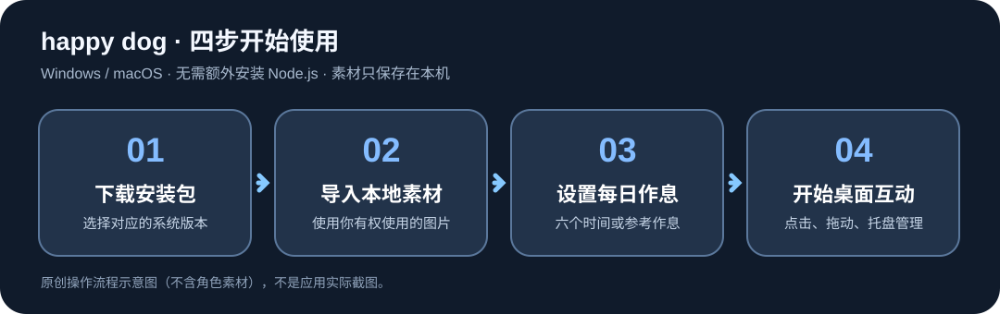

# xian tiao xiao gou

**happy dog · 小狗的一天**

<a href="https://fastly.jsdelivr.net/gh/rwei14257-design/xiantiao-xiaogou-zhuochong@beb61afe317177979ca3a4abba6c1e8b8d66885f/src/assets/app-icon.png"></a>

**跟着你的作息，一起吃饭、休息、认真生活。**

非官方 Windows / macOS 桌面陪伴应用。目标萌宠一直是线条小狗；运行用角色图片由使用者自行提供，安装包附带双狗合照应用图标，不附带运行用的角色动画素材。下方展示导入本地素材后的实际效果。

**🚀 [五分钟图文上手](docs/USER_GUIDE.md)** · **[下载 Windows / Mac 安装包](https://github.com/rwei14257-design/xiantiao-xiaogou-zhuochong/releases/latest)** · [状态图鉴](#每个状态会做什么) · [素材导入](#把自己的小狗素材放进来) · [版权声明](NOTICE.md)

## 新手快速上手

[](docs/USER_GUIDE.md)

**第一次使用只需四步：** 下载对应系统版本 → 在小屋导入有权使用的图片文件夹 → 调整「我的作息时间」→ 与桌面角色互动。

| 操作页面 | 直接学习 |
| --- | --- |
| 下载安装、校验文件、首次运行 | [图文指南：安装与启动](docs/USER_GUIDE.md#1-下载与安装) |
| 角色素材如何命名、导入、排错 | [图文指南：导入本地素材](docs/USER_GUIDE.md#2-首次启动与素材导入) |
| 音乐舞池、专注搭子、惊喜表情、作息按钮 | [小屋功能位置示意图](docs/images/guide-panel-map.svg) |
| 鼠标、键盘、托盘与恢复窗口 | [桌面操作与常见问题](docs/USER_GUIDE.md#6-桌面互动和快捷操作) |

> **重要：** 安装包不含第三方角色动画。新手教程的流程图和界面布局图为原创示意，不是含线条小狗形象的真实截图；实际截图与第三方权利边界仍见 [截图说明](docs/screenshots.md)。


[](https://fastly.jsdelivr.net/gh/rwei14257-design/xiantiao-xiaogou-zhuochong@v1.2.0/docs/images/preview-home.png)

截图展示的是已导入本地线条小狗素材的应用，下载后需自行导入才能获得同样的角色效果。截图中的角色形象归相应权利人所有，**不属于本项目 MIT 授权范围**；项目未取得角色公开展示或再分发授权，也不将截图展示视为已获授权。详见 [截图来源与权利说明](docs/screenshots.md)。

[](https://fastly.jsdelivr.net/gh/rwei14257-design/xiantiao-xiaogou-zhuochong@beb61afe317177979ca3a4abba6c1e8b8d66885f/docs/images/day-rhythm.svg)

图片未显示时，可直接打开：[小屋大图](https://fastly.jsdelivr.net/gh/rwei14257-design/xiantiao-xiaogou-zhuochong@v1.2.0/docs/images/preview-home.png) · [12 种状态大图](https://fastly.jsdelivr.net/gh/rwei14257-design/xiantiao-xiaogou-zhuochong@v1.2.0/docs/images/preview-states.png)。

## 桌面互动（v1.3.0）

- 悬停在小狗身上会蹦跳，拖动时庆祝，滚轮触发翻滚。小狗下方不显示按钮栏。按 Shift 滚动可调整大小（120–420），右键可打开小屋或选择大小。
- 小狗获得焦点后，回车、删除、Ctrl/Cmd+S、Ctrl/Cmd+Z 分别触发送出、删除、夸奖和撤销动画。可导入同名 `send.gif`、`delete.gif`、`undo.gif` 和任务庆祝 `usageOver3Hours.gif`；没有专用素材时沿用基础动作。
- 「跨应用互动」默认关闭。开启后，本机辅助程序只向桌宠发送预定义的滚轮和按键动作名，不保存输入内容；Mac 可能需要在系统设置中允许输入监控后重新开启。关闭开关即停止辅助程序。
- 在「调整我的作息时间」选择参考作息，或继续使用自定义作息。05:20 / 17:20 出现爱心，下一分钟切换庆祝。手动互动仍优先，睡眠不会被音乐打断。
- 托盘支持登录时启动、清理界面缓存、完成任务庆祝。运行 `"happy dog.exe" --task-complete` 可通知已有桌宠庆祝，不打开第二只小狗。

[逐项对照与验证](docs/reference-v1.3.0.md) · 参考：[remake1026/desktop-pets](https://github.com/remake1026/desktop-pets)。保留 happy dog 无对白、五秒点击反馈、专注与音乐小屋。

## 小屋里的新玩法

- **音乐舞池**：开启「跟随播放」和自动作息，播放器播放时跳舞，暂停后恢复。Windows 读取系统媒体会话；有的浏览器或视频播放器不会标注媒体类型，有的播放器不报告状态。Mac 查询正在运行的 Music 或 Spotify，可能需要在系统设置中允许自动化。此功能不录音、不读取歌名，不按 BPM 分析节拍。
- **专注搭子**：一起安静阅读 25 分钟，可提前结束；自然结束时播放庆祝动作。计时限本次运行。
- **惊喜表情**：随机抽取爱心泡泡、流星跳跃、彩纸庆祝或闪光舞步，连续两次不重复。可额外导入 `surprise-hearts.gif`、`surprise-stars.gif`、`surprise-confetti.gif` 和 `surprise-beats.gif`（也支持 PNG/WebP）；缺少这些表情时，在常规动作上叠加粒子效果。点击互动仍保持 5 秒。

[音乐联动与桌宠窗口实测记录](docs/validation-v1.2.0.md)

## 下载与安装

| 设备 | v1.3.1 安装包 |
| --- | --- |
| Windows 10 / 11，64 位 | [Windows 安装程序](https://github.com/rwei14257-design/xiantiao-xiaogou-zhuochong/releases/download/v1.3.1/happy-dog-1.3.1-Windows-x64-Setup.exe) |
| Mac，Apple Silicon（M 系列） | [macOS ARM64 DMG](https://github.com/rwei14257-design/xiantiao-xiaogou-zhuochong/releases/download/v1.3.1/happy-dog-1.3.1-macOS-arm64.dmg) |
| Mac，Intel 芯片 | [macOS Intel DMG](https://github.com/rwei14257-design/xiantiao-xiaogou-zhuochong/releases/download/v1.3.1/happy-dog-1.3.1-macOS-x64.dmg) |

安装包由仓库内的 GitHub Actions 在对应平台构建，包含官方 Electron 运行时，不需要另外安装 Node.js。下载前可查看 [构建状态](https://github.com/rwei14257-design/xiantiao-xiaogou-zhuochong/actions/workflows/release.yml)；每次成功发布都附有 `SHA256SUMS.txt`。

Windows：运行安装程序，按提示选择安装目录。Mac：打开 DMG，将应用拖入 Applications。首次启动会打开小屋，引导导入本地素材。

Windows 暂无可信发布者证书签名；Mac 使用 ad-hoc 签名，尚无 Apple Developer ID 签名和公证。系统可能提示无法验证发布者；请确认下载来源和校验值，按系统提供的安全设置流程处理，不需要关闭系统整体防护。Mac 安装包在对应平台原生构建，完整实机交互体验仍需反馈。

## 它会怎样陪你

- **跟随作息**：起床、早餐、午餐、午休、喝水、下班、晚餐、睡前放松、夜间睡眠。
- **六个时间自己定**：在小屋调整起床、三餐、下班、睡觉时间，保存后立即生效。
- **互动之后回到生活**：手动选择动作后保留 5 秒，再回到当前时间应有的状态；也可以点「回到作息」。连续点击从最后一次重新计时。关闭作息后，摸小狗也只互动 5 秒，再回到选定的固定动作。
- **周末节奏**：工作日专注时段安静阅读，周末改为轻松陪伴。
- **桌面轻陪伴**：透明窗口、拖动、空白区域鼠标穿透、三档大小、置顶、托盘隐藏与唤回。
- **安装版可换素材**：从文件夹导入 GIF / PNG / WebP，素材保存在用户数据目录，升级不会覆盖。

所有作息使用电脑的**系统本地时间**。电脑休眠后唤醒会重新计算当前状态，不会把错过的提醒逐条补播。

## 每个状态会做什么

[](https://fastly.jsdelivr.net/gh/rwei14257-design/xiantiao-xiaogou-zhuochong@v1.2.0/docs/images/preview-states.png)

每张卡片对应一个实际动作：小狗形态、状态名称、触发时间放在一起。小屋中的 GIF 会播放，以上为 v1.2.0 实际界面的静态截图；小狗只播放动作，桌面和小屋都不再显示小狗台词；卡片时间会随个人作息设置更新。

| 状态 | 默认触发方式 | 行为和恢复规则 | 本地文件名 |
| --- | --- | --- | --- |
| 见面摇摇 | 07:30–07:50；日常放松、周末 | 早安问候，其他时间轻松陪伴 | `hello.gif` |
| 给你爱心 | 点击小狗、爱心按钮或状态卡 | 陪你互动 5 秒，再回到作息 | `heart.gif` |
| 开心蹦跶 | 工作日专注时段，每小时最后 5 分钟；手动 | 伸展一下，用餐、午休和睡眠优先 | `jump.gif` |
| 夸夸小狗 | 手动选择；爱心状态下再次点击 | 播放鼓励动作，5 秒后恢复 | `good.gif` |
| 快乐起舞 | 手动选择 | 让小狗开心一下，5 秒后恢复 | `dance.gif` |
| 开饭时间 | 08:00–08:30、12:15–12:55、18:45–19:25 | 对应早餐、午餐、晚餐；分别显示问候 | `eat.gif` |
| 安静陪伴 | 工作日 09:00 至下班时间，其他事件之外 | 安静阅读，让你专心做事 | `read.gif` |
| 呼呼大睡 | 12:55–13:15 午休；23:15–次日07:30 | 午休随午餐时间移动；夜间睡眠跨午夜 | `sleep.gif` |
| 喝口水吧 | 10:30–10:40、15:00–15:10 | 温和提醒喝水，随后恢复日常状态 | `drink.gif` |
| 下班快乐 | 18:00–18:30；手动 | 工作日收工提醒，周末为傍晚放松 | `offwork.gif` |
| 睡前放松 | 睡觉时间前 30 分钟，默认22:45–23:15 | 慢慢收心，之后进入睡眠 | `sleepy.gif` |
| 完成庆祝 | 手动选择 | 为完成的事情庆祝，5 秒后恢复 | `celebrate.gif` |

表中时间是默认值。时间发生重叠时，夜间睡眠、睡前放松、早安、用餐、午休、下班、喝水依次优先；手动互动临时覆盖作息，固定动作模式则暂停自动切换。

## 把自己的小狗素材放进来

1. 准备你自行创作、获得许可或有其他合法使用依据的线条小狗 GIF / PNG / WebP。
2. 使用上表文件名。也支持同名 `.png` 和 `.webp`，优先级为 GIF → PNG → WebP；建议透明背景、正方形画布，每个文件不超过 15 MB。
3. 打开小屋 →「导入本地素材」→ 选择文件夹。也可以点「打开素材目录」查看本地文件。
4. 成功导入后立即刷新。缺少的状态保留功能示意图，不会换成别的角色。

为兼容已有本地文件，也识别 `turn on.gif`、`music-dance.gif`、`mealtime.gif`、`morning-reading.gif`、`morning-drink.gif`、`after-work.gif`、`sleepy2.gif`、`special.gif` 等文件名。这里只识别用户已有文件，不下载、抓取或从应用包中提取素材。

素材保存在 Windows `%APPDATA%\PuppyCompanion-Code\pet-assets`，或 macOS `~/Library/Application Support/PuppyCompanion-Code/pet-assets`。源码开发时也支持被 Git 忽略的 `assets-local/`。素材与设置不上传。

拥有图片副本、购买聊天表情或注明出处，并不自动获得公开传播和随安装包再分发的权利。素材授权范围见 [素材政策](ASSET_POLICY.md)；本次网上检索结果见 [资源核查](docs/resource-research.md)。

## 桌面操作

| 操作 | 效果 |
| --- | --- |
| 按住角色拖动 | 调整位置，松开后保存 |
| 单击角色 | 爱心 / 夸夸互动 |
| 右键角色 | 状态、尺寸、作息、导入、隐藏与退出菜单 |
| 角色下方的房子按钮 | 打开小屋 |
| 单击托盘图标 | 显示角色 |
| 双击托盘图标 | 打开小屋 |
| 菜单 → 回到屏幕右下角 | 找回角色 |

关闭小屋不退出桌宠；完整退出请使用托盘或右键菜单。

## 从源码运行与构建

需要 Node.js 22.12+（含 npm）。

```sh
git clone https://github.com/rwei14257-design/xiantiao-xiaogou-zhuochong.git
cd xiantiao-xiaogou-zhuochong
npm ci
npm start
```

```sh
npm test
npm run check:release
npm run test:smoke
npm run dist:win   # 在 Windows 构建 NSIS 安装包
npm run dist:mac   # 在 Mac 构建 ARM64 / Intel DMG
```

功能示意图来自 `scripts/generate-illustrations.js`；`npm run docs:images` 可重新生成这些示意图，不会修改合照应用图标或界面截图。作息逻辑在 `src/schedule.js`，素材读取和导入在 `src/artwork.js`。打包采用 `electron-builder.yml` 的文件白名单，CI 仅允许已登记的两个运行时图标，不允许用户动画素材进入应用包。

## 版权、免责声明与致谢

本项目为非官方学习和交流项目，与线条小狗相关权利人不存在已确认的合作、赞助或授权关系。项目名称用于说明学习参考主题，不主张第三方角色或标识权利。

本项目未取得线条小狗角色素材的公开再分发授权，安装包附带已登记的合照应用图标，不附带原始角色动画素材；文档包含两张导入本地素材后的功能截图，截图内第三方角色的公开展示权尚未取得确认。**免责声明、非商业目的和侵删承诺均不能替代事先授权。**

本项目有权许可的代码、文档和功能图示采用 [MIT License](LICENSE)；第三方角色、商标、用户素材和依赖组件按各自权利与许可处理。合照图标由本机双狗素材辅助生成，相关第三方角色权利未因此获得授权，见 [图标说明](resources/icons/README.md)。完整说明：[NOTICE](NOTICE.md) · [素材政策](ASSET_POLICY.md) · [第三方声明](THIRD_PARTY_NOTICES.md)。

感谢 [remake1026/desktop-pets](https://github.com/remake1026/desktop-pets) 的桌宠交互和展示思路。开发时阅读过其参考程序，不将其未提供明确许可的代码或表情包当作已获授权的资源。本版本的可调整作息、周末节奏、互动恢复、状态图鉴与素材管理按本项目需求实现。

权利反馈请通过 [Issues](https://github.com/rwei14257-design/xiantiao-xiaogou-zhuochong/issues) 提供具体文件、权利依据和诉求；维护者会核实处理。此渠道不代替使用前的授权。
