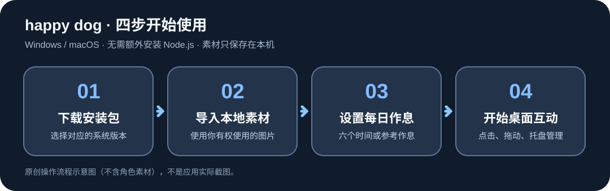
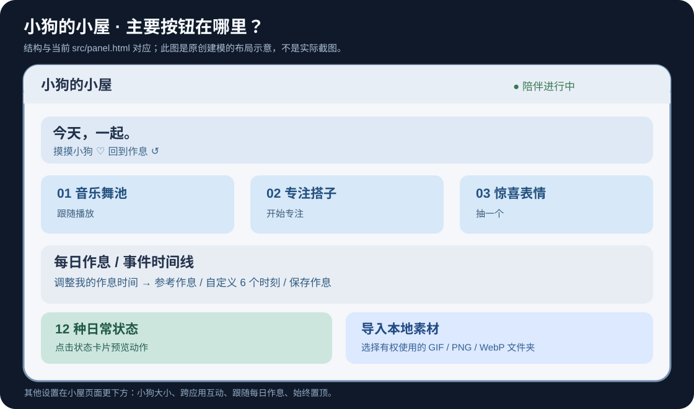
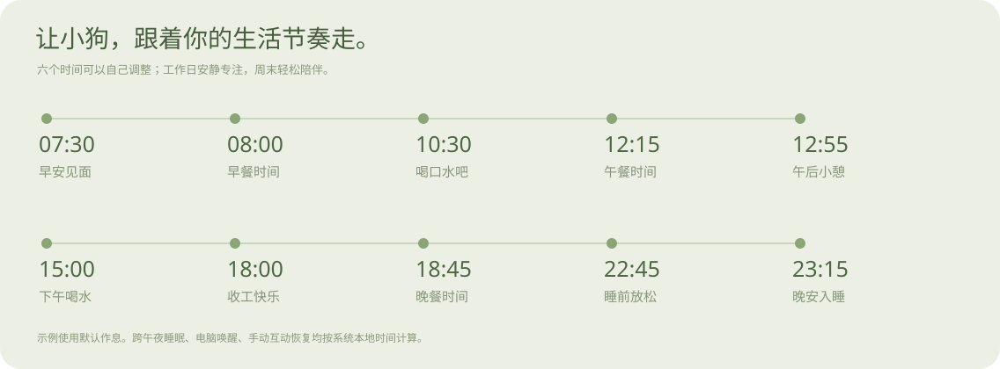

# happy dog｜从下载安装到日常使用（图文教程）

> 适用：**v1.3.1** 的 Windows 10/11 x64、macOS Apple Silicon / Intel 版本。本文对应仓库当前的 `src/panel.html`、`src/pet.html` 和项目 README。
>
> **版权提示：** 这是非官方桌面陪伴应用。安装包不包含用于运行动画的第三方角色素材；请仅导入自己创作、已获授权或有其他合法依据使用的本地图片。本教程的两张 SVG 是原创界面结构示意图，**不是实际界面截图**，也不含第三方角色形象。

[返回 README](../README.md) · [下载安装包](https://github.com/rwei14257-design/xiantiao-xiaogou-zhuochong/releases/latest) · [操作与素材政策](../ASSET_POLICY.md) · [反馈问题](https://github.com/rwei14257-design/xiantiao-xiaogou-zhuochong/issues)



## 目录

1. [下载与安装](#1-下载与安装)
2. [首次启动与素材导入](#2-首次启动与素材导入)
3. [认识小狗的小屋](#3-认识小狗的小屋)
4. [设置跟随你的作息](#4-设置跟随你的作息)
5. [音乐舞池专注与惊喜表情](#5-音乐舞池专注与惊喜表情)
6. [桌面互动和快捷操作](#6-桌面互动和快捷操作)
7. [常见问题与排查](#7-常见问题与排查)
8. [源码运行与验证](#8-源码运行与验证)

## 1. 下载与安装

| 设备 | 选择文件 | 如何安装 |
|---|---|---|
| Windows 10 / 11，64 位 | [v1.3.1 Windows Setup.exe](https://github.com/rwei14257-design/xiantiao-xiaogou-zhuochong/releases/download/v1.3.1/happy-dog-1.3.1-Windows-x64-Setup.exe) | 打开安装包，按提示完成安装 |
| Mac，Apple Silicon M 系列 | [v1.3.1 macOS ARM64 DMG](https://github.com/rwei14257-design/xiantiao-xiaogou-zhuochong/releases/download/v1.3.1/happy-dog-1.3.1-macOS-arm64.dmg) | 打开 DMG，将应用拖入 Applications |
| Mac，Intel 芯片 | [v1.3.1 macOS x64 DMG](https://github.com/rwei14257-design/xiantiao-xiaogou-zhuochong/releases/download/v1.3.1/happy-dog-1.3.1-macOS-x64.dmg) | 打开 DMG，将应用拖入 Applications |

**安装前确认：**

- 从仓库的 [Releases](https://github.com/rwei14257-design/xiantiao-xiaogou-zhuochong/releases) 下载，不要依赖不明第三方下载站。
- 若发布页面附有 `SHA256SUMS.txt`，可在 Windows PowerShell 用 `Get-FileHash .\安装包文件名 -Algorithm SHA256`；Mac 终端用 `shasum -a 256 文件名.dmg`，并与发布页校验值比较。
- **普通用户无需安装 Node.js**；源码开发者才需要。
- Windows 当前没有可信发布者的代码签名，Mac 包尚无 Apple Developer ID 公证；若遇系统安全提示，先核实来源与哈希值，按系统提供的安全设置流程决定是否继续，**不需要关闭整个系统的安全保护**。

## 2. 首次启动与素材导入

首次打开应用会显示「**小狗的小屋**」。如果看不到角色动画而只有占位示意，这是预期行为，不是安装失败——项目不随安装包分发第三方 GIF。

1. 事先在电脑上准备一个本地文件夹，放入你有权使用的 GIF、PNG 或 WebP。建议使用透明背景、正方形画布。
2. 在小屋内找到「**让你的小狗住进来**」，点击 **导入本地素材**。
3. 在系统文件选择窗口选择该文件夹，等待完成。界面会显示导入了多少种状态、跳过了多少文件。
4. 点击 **打开素材目录 ↗** 可以查看应用保存的素材；小屋内的角色预览和状态卡会自动刷新。
5. 不必一次准备全部 12 个动作：缺少的状态会保留占位示意。每个文件建议不超过 15 MB。

**常用文件名**

| 状态 | 文件名 | 状态 | 文件名 |
|---|---|---|---|
| 早安陪伴 | `hello.gif` | 爱心互动 | `heart.gif` |
| 跳跃伸展 | `jump.gif` | 夸奖互动 | `good.gif` |
| 跳舞 | `dance.gif` | 用餐 | `eat.gif` |
| 安静阅读 | `read.gif` | 睡眠 | `sleep.gif` |
| 喝水提醒 | `drink.gif` | 下班 | `offwork.gif` |
| 睡前放松 | `sleepy.gif` | 庆祝 | `celebrate.gif` |

同名 `.png` / `.webp` 也支持；当同名不同格式同时存在时，优先 GIF → PNG → WebP。额外互动可以提供 `send.gif`、`delete.gif`、`undo.gif`、`usageOver3Hours.gif` 与惊喜效果素材；缺少时回退到基础动作。

**本机保存路径**

- Windows：`%APPDATA%\PuppyCompanion-Code\pet-assets`
- Mac：`~/Library/Application Support/PuppyCompanion-Code/pet-assets`

素材与个人设置保存在你的本机数据目录。**个人拥有图片文件的副本，不代表有权公开传播角色素材。** 详情见 [素材政策](../ASSET_POLICY.md)。

## 3. 认识小狗的小屋



图中所有区块名称都来自当前实际小屋界面，位置为便于理解而简化：

- 顶部 **「摸摸小狗 ♡」**：立即互动；**「回到作息 ↺」**：结束临时动作，恢复按时间安排。
- **音乐舞池、专注搭子、惊喜表情**：分别用于播放状态联动、25 分钟专注和随机表情。
- **每日作息 / 事件时间线**：显示正在进行与接下来发生的事件，并允许修改作息。
- **12 种日常状态**：点击状态卡切换动作；日常模式下，短暂互动后会回到原作息。
- **导入本地素材**：从自己的文件夹选择角色动画，刷新小屋画面。
- 更下方的设置包括三档大小、**跨应用互动**、**跟随每日作息**、**始终在最上面**。

可对照 [12 种状态的原创建模图鉴](images/states.svg) 与 [默认作息时间线](images/day-rhythm.svg)。仓库另有真实界面截图，但其中的第三方角色展示权未确认授权，须单独阅读 [截图来源与权利说明](screenshots.md)。

## 4. 设置跟随你的作息

1. 在小屋中展开 **「调整我的作息时间」**。
2. 想直接采用预置时间段，可勾选 **「参考作息 · 固定时段」**。
3. 想跟随自己的节奏，取消勾选参考作息；编辑 **起床、早餐、午餐、下班、晚餐、睡觉** 六个时间并点击 **保存作息**。
4. 保持 **「跟随每日作息」** 开启；角色会依据电脑本地时间切换，周末和工作日的日常活动有所区别。
5. 点击状态卡或桌面角色会触发短暂动作，通常约 **5 秒** 后自动恢复；想直接恢复可点「回到作息」。



**示例：** 若你希望 07:30 起床、08:00 早餐、12:15 午餐、18:00 下班、18:45 晚餐、23:15 睡觉，可保持默认时间。若作息与此不同，直接修改对应时间。睡眠、就餐和提醒可能重叠，程序按事件优先级处理。

## 5. 音乐舞池、专注与惊喜表情

| 功能 | 如何操作 | 预期表现 / 限制 |
|---|---|---|
| 音乐舞池 | 小屋中的 **跟随播放** 开关，并开启自动作息 | 检测到支持的播放器正在播放时触发舞步；暂停后恢复日常动作。Windows 使用媒体会话，Mac 检测 Music / Spotify；不录音、不读取歌名，也不分析 BPM |
| 专注搭子 | 点击 **开始专注** | 开始 25 分钟安静陪伴；到期触发庆祝，可提前点击 **结束专注**；只在当前运行期间计时 |
| 惊喜表情 | 点击 **抽一个** | 随机触发爱心、流星、彩纸或闪光效果，尽量避免连续重复 |

这三个功能不需要向任何云端服务上传个人作息或媒体内容。若你的播放器未报告播放状态，音乐舞池可能无法联动，这不必然是程序故障。

## 6. 桌面互动和快捷操作

| 操作 | 作用 |
|---|---|
| 单击角色 | 爱心／夸夸等短暂互动 |
| 鼠标悬停 | 触发轻微跳跃反馈（受当前状态优先级影响） |
| 按住并拖动 | 移动桌宠，松手后保存位置 |
| 滚轮 | 触发翻滚 |
| Shift + 滚轮 | 调整连续尺寸，约 120–420 |
| 右键角色 | 打开状态、大小、作息、隐藏或退出等菜单 |
| 单击系统托盘图标 | 唤回桌宠 |
| 双击托盘图标 | 打开小屋 |
| 角色具有键盘焦点时按 Enter / Delete | 触发送出 / 删除动作 |
| 角色具有键盘焦点时按 Ctrl/Cmd+S、Ctrl/Cmd+Z | 夸奖 / 撤销动画 |

> 「跨应用互动」默认关闭；只有在你自行开启后，才允许本机辅助程序把预定义的输入动作通知桌宠。Mac 可能要求输入监控或辅助功能权限。关闭开关即可停止该辅助程序。不要把这些焦点快捷键误认为在任意应用中都会触发。

## 7. 常见问题与排查

| 问题 | 建议检查 |
|---|---|
| 安装后只有占位图、没有小狗 | 这是默认行为；通过「导入本地素材」导入你有权使用的图片 |
| 导入后有些动作仍为占位图 | 核对 12 个文件名、扩展名、文件是否损坏，以及导入结果的跳过数量 |
| 关闭小屋后，找不到桌宠 | 检查系统托盘；右键菜单可以选择「回到屏幕右下角」 |
| 音乐舞池不动 | 开启跟随播放和自动作息，使用支持播放状态检测的播放器；Mac 核实授权 |
| 调整作息后不变化 | 检查「跟随每日作息」是否开启、系统本地时间是否正确、是否处于手动互动期间 |
| Mac 提示权限或无法验证开发者 | 确认下载来源及校验值，并参考 macOS 的系统安全说明；不要关闭系统整体防护 |
| Windows 安装出现陌生发布者提示 | 当前没有可信发布者代码签名；先核对 GitHub Release 和 SHA256，再做安全判断 |
| 想彻底关闭程序 | 从系统托盘或右键菜单选择退出，仅关闭小屋窗口不会退出桌宠 |

## 8. 源码运行与验证

开发者需要 Node.js **22.12+**。安装版用户可跳过本节。

```bash
git clone https://github.com/rwei14257-design/xiantiao-xiaogou-zhuochong.git
cd xiantiao-xiaogou-zhuochong
npm ci
npm start
```

运行回归与发布检查：

```bash
npm test
npm run check:release
npm run test:smoke
```

安装包由对应平台的 GitHub Actions 构建。源代码与自有图示按仓库 [LICENSE](../LICENSE) 许可；第三方角色形象、用户素材和未获授权的图标不在该 MIT 许可范围内。

---

### 文档编排参考

本教程借鉴高关注开源仓库常见的文档结构：显眼的下载入口、图示快速上手、可复制操作步骤、FAQ 和版权边界；未复制示例仓库的素材或文字。

- [Best-README-Template](https://github.com/othneildrew/Best-README-Template) — 目录、使用说明与清晰的下载／文档入口。
- [awesome-readme](https://github.com/matiassingers/awesome-readme) — 图示、演示和清晰的说明文档。
- [TanStack Query](https://github.com/TanStack/query) — 让使用者在 README 首屏快速找到文档与安装入口。
